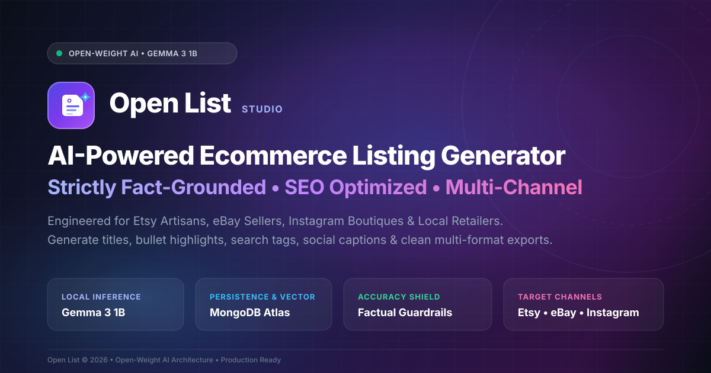
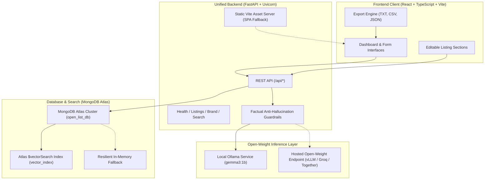

<p align="center">
  
</p>

# Open List 🛍️✨
### AI-Powered Ecommerce Listing Generator Powered by Open-Weight Models & MongoDB Atlas

Open List is a modern, production-minded web application engineered for small businesses, independent artisans, Etsy/eBay sellers, Instagram boutiques, and local retailers. It transforms basic product specifications into SEO-optimized ecommerce listings, targeted search keywords, bullet-point highlights, and engaging social media captions using open-weight AI (**Gemma 3 1B** via Ollama) and **MongoDB Atlas**.

---

## 🏗️ System Architecture



---

## 🌟 Core Features

- **A. AI Product Listing Generator**:
  - Accepts product name, category, features & technical specs, price/currency, audience, brand name, brand voice, target channel (General ecommerce, Etsy, eBay, Instagram, WhatsApp), and language.
  - Strict anti-hallucination guardrails: Never invents unverified materials, certifications, medical claims, or fake reviews.
  - Generates SEO title, narrative description, 5 key highlights, 7-10 keyword tags, social media caption with hashtags, call to action, and alternative title suggestions.
  - Validated with Pydantic JSON schemas.
- **B. Editable Results & Export**:
  - Live in-place editing for every generated section.
  - One-click copy buttons for individual sections or entire formatted listing.
  - Per-section regeneration (refine title or rewrite social caption without regenerating the whole listing).
  - Alternative title selector (1-click title swap).
  - Multi-format export: Download as formatted Text (.txt), Spreadsheet (.csv), or structured (.json).
- **C. Listing History & Management**:
  - Persisted to MongoDB Atlas.
  - Paginated history with keyword search filter.
  - Re-open, edit, reuse, or delete saved listings.
- **D. Seller Brand Profile & Guardrails**:
  - Store brand voice, target demographic, preferred terminology, and forbidden words blacklist.
  - Separate system instructions prevent user input prompt-injection from overriding safety guardrails.
- **E. MongoDB Atlas Vector Search with Truthful Fallback**:
  - Generates dense vector embeddings for listings.
  - Performs semantic similarity queries via MongoDB Atlas `$vectorSearch`.
  - Truthful fallback: When Atlas Vector Search index is not yet configured, automatically and honestly falls back to MongoDB keyword matching without failing or faking AI results.
- **F. Demo Mode & Quick-Start Presets**:
  - Pre-seeded sample products (Ceramic Mug, Soy Candle, Leather Wallet, Bamboo Matcha Whisk) for 1-click evaluation without typing.

---

## 📋 Prerequisites

- **OS**: Windows 10/11, macOS, or Linux (optimized for 8 GB RAM laptop)
- **Python**: 3.11+ (Python 3.13 supported)
- **Node.js**: v18+ or v20+ (with npm)
- **Ollama**: Installed locally ([ollama.com](https://ollama.com))
- **MongoDB Atlas**: Free M0 Sandbox cluster (or run in resilient in-memory fallback mode)

---

## 🚀 Quick-Start Guide (Windows Local Setup)

### 1. Verify / Install Ollama and Gemma 3 1B
Open a PowerShell terminal:
```powershell
# Pull the open-weight Gemma 3 1B model (approx 800 MB)
ollama pull gemma3:1b

# Verify Ollama is serving
ollama list
```
*Note: Make sure the Ollama desktop service is active.*

### 2. Clone and Setup Environment
```powershell
cd c:\Users\ADMIN\OneDrive\Desktop\hw2

# Copy environment template
cp .env.example .env
```

Review or edit `.env` (defaults are preconfigured for local development):
```env
PORT=8000
ENVIRONMENT=development
AI_PROVIDER=ollama
OLLAMA_BASE_URL=http://localhost:11434
OLLAMA_MODEL=gemma3:1b
MONGODB_URI=
DATABASE_NAME=open_list_db
VECTOR_SEARCH_INDEX_NAME=vector_index
```
*(If `MONGODB_URI` is left blank, Open List operates in resilient in-memory mode so you can test immediately without credentials).*

The application automatically seeds four demo listings on startup: a ceramic mug,
soy candle, leather cardholder, and bamboo matcha whisk. With no MongoDB URI,
these records are available for the current run in in-memory mode. With a valid
MongoDB URI, they are inserted into the `open_list_db.listings` collection only
if those sample IDs do not already exist.

### 3. Install Backend Dependencies
```powershell
pip install -r requirements.txt
```

### 4. Build the Frontend
```powershell
cd frontend
npm install
npm run build
cd ..
```

### 5. Launch the Application
The backend serves the compiled frontend, so the application can be built and started from one terminal:
```powershell
npm run start
```

Run that command from the repository root. It builds `frontend/dist` and then starts the FastAPI server.

To rebuild only the frontend:
```powershell
npm run build
```

Open your browser at:
- **Application Interface**: [http://127.0.0.1:8000](http://127.0.0.1:8000)
- **Interactive Swagger API Docs**: [http://127.0.0.1:8000/docs](http://127.0.0.1:8000/docs)
- **Readiness Probe**: [http://127.0.0.1:8000/api/health/ready](http://127.0.0.1:8000/api/health/ready)

*(For frontend hot-reloading development, run `npm run dev` inside `frontend/` on port 5173).*

---

## 🍃 MongoDB Atlas Setup & Vector Search Configuration

### Step 1: Create a Free Cluster
1. Register at [mongodb.com/atlas](https://www.mongodb.com/atlas).
2. Create a free **M0 Sandbox** cluster.
3. Under **Database Access**, create a database user with read/write privileges.
4. Under **Network Access**, add your current IP address (or `0.0.0.0/0` for cloud deployment like Render).
5. Obtain your connection string and add it to `.env`:
   ```env
   MONGODB_URI=mongodb+srv://<username>:<password>@cluster0.abcde.mongodb.net/?retryWrites=true&w=majority
   DATABASE_NAME=open_list_db
   ```

### Step 2: Configure Atlas Vector Search ($vectorSearch)
1. In the Atlas web console, select your cluster.
2. Navigate to **Atlas Search** &rarr; **Create Search Index**.
3. Select **Atlas Vector Search (JSON Editor)**.
4. Target Database: `open_list_db`, Target Collection: `listings`.
5. Name the index: `vector_index`.
6. Paste the following index definition:
```json
{
  "fields": [
    {
      "type": "vector",
      "path": "embedding",
      "numDimensions": 768,
      "similarity": "cosine"
    }
  ]
}
```
7. Click **Create Vector Search Index**.
*Once index creation completes, semantic searches via `/api/search` automatically utilize `$vectorSearch`!*

---

## ☁️ Render Deployment Guide

Open List is designed for zero-friction deployment on Render via the included `render.yaml` Blueprint.

### Unified Single-Service Architecture
Render uses a single Web Service that:
1. Installs Node dependencies and compiles Vite static files into `frontend/dist`.
2. Installs Python dependencies from `requirements.txt`.
3. Starts FastAPI with Uvicorn.
4. FastAPI serves API endpoints on `/api/*` and acts as the SPA static server for all client routes.

### Three Deployment Modes:
- **Mode A (Local Dev)**: Laptop running local Ollama with `gemma3:1b`.
- **Mode B (Render Demo + Remote Inference)**: Render web service connected to an OpenAI-compatible open-weight endpoint (e.g. Together AI, Groq, RunPod, or self-hosted vLLM) hosting open-weight models (`google/gemma-2-9b-it` or `meta-llama/Meta-Llama-3-8B-Instruct`).
- **Mode C (Render Standalone Demo)**: Render starts cleanly without remote LLM credentials. The dashboard, listing history, export tools, and demo previews work seamlessly, and live generation displays a clear, actionable configuration message.

### Deploying to Render:
1. Push your repository to GitHub.
2. In the Render Dashboard, click **New +** &rarr; **Blueprint**.
3. Select your repository (`render.yaml` is automatically recognized).
4. Fill in the optional environment variables when prompted:
   - `MONGODB_URI`: Your MongoDB Atlas connection string.
   - `AI_PROVIDER`: `hosted_openai_compatible` (or leave default for demo mode).
   - `OPENAI_COMPATIBLE_BASE_URL`: Endpoint URL (e.g. `https://api.together.xyz/v1`).
   - `OPENAI_COMPATIBLE_API_KEY`: API key for the remote provider.
5. Click **Apply**. Render builds the frontend, installs Python packages, and deploys the unified service!

---

## 🧪 Automated Testing

Automated test suite covers health checks, input validation, AI JSON extraction, mocked generation, Atlas CRUD, 503 unavailable provider handling, and SPA static routing:

Run the test suite:
```powershell
pytest -v
```

---

## ⚙️ Environment Variables Reference

| Variable | Default | Purpose |
| :--- | :--- | :--- |
| `PORT` | `8000` | Port for the FastAPI server |
| `ENVIRONMENT` | `development` | Deployment environment (`development` / `production`) |
| `AI_PROVIDER` | `ollama` | AI runtime (`ollama` or `hosted_openai_compatible`) |
| `OLLAMA_BASE_URL` | `http://localhost:11434` | Ollama HTTP endpoint |
| `OLLAMA_MODEL` | `gemma3:1b` | Open-weight model name |
| `OPENAI_COMPATIBLE_BASE_URL` | `""` | Optional remote inference endpoint |
| `OPENAI_COMPATIBLE_API_KEY` | `""` | Optional API key for remote inference endpoint |
| `OPENAI_COMPATIBLE_MODEL` | `google/gemma-2-9b-it` | Model identifier for remote inference |
| `MONGODB_URI` | `""` | Atlas connection string (in-memory fallback if empty) |
| `DATABASE_NAME` | `open_list_db` | MongoDB database name |
| `VECTOR_SEARCH_INDEX_NAME` | `vector_index` | Name of the Atlas vector search index |
| `CORS_ORIGINS` | `*` | Allowed CORS origins |

---

## 🛡️ Security, Reliability & Factuality

- **Factual Anti-Hallucination Guardrails**: Prompts strictly command the model to only use supplied materials, features, and specs.
- **Prompt Injection Defense**: Product facts are isolated in distinct `<product_information>` tags separate from system safety and brand tone instructions.
- **Zero Exposed Secrets**: Database credentials and API keys are stored strictly in backend environment variables and never bundled into frontend assets.
- **Fail-Safe Fallbacks**: If MongoDB Atlas or Ollama is temporarily offline, the server returns informative HTTP 503/502 JSON error payloads with troubleshooting guidance instead of crashing.

---

## 🔮 Future Roadmap

- Automated multi-channel publishing direct to Etsy and Shopify APIs.
- Multi-user authentication & workspace roles with JWT/OAuth2.
- Local open-source product image generation (Stable Diffusion / Flux).
- Automated inventory synchronization.

---

## 📄 License
MIT License. Built for independent creators and merchants everywhere.
